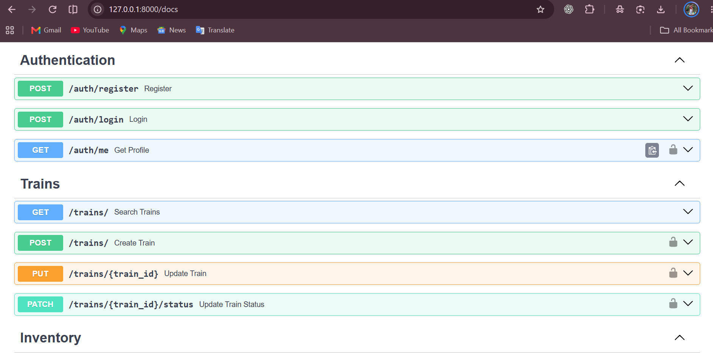

# Mini Railway Booking System

A backend REST API for a railway reservation system built using **Python, FastAPI, SQLAlchemy, and SQLite**.

The application supports customer registration, JWT authentication, train management, seat inventory, ticket booking, PNR generation, booking history, and ticket cancellation.

## 1. Features

### Authentication
- Customer registration
- User login
- JWT-based authentication
- Password hashing
- Admin authentication and role-based access

### Train Management
- Add new trains (admin only)
- Update train details (admin only)
- Activate or deactivate trains (admin only)
- Search active trains
- Search trains by source and destination

### Seat Inventory
- Add seat inventory for trains (admin only)
- Manage journey dates
- Support multiple travel classes
- Check seat availability

### Ticket Booking
- Book railway tickets
- Generate unique 10-digit PNR numbers
- Automatically reduce available seats
- View personal booking history
- View booking details using PNR

### Ticket Cancellation
- Cancel confirmed bookings
- Automatically restore available seats
- Prevent repeated cancellation

## 2. Technology Stack

| Technology | Purpose |
|---|---|
| Python 3.12 | Programming language |
| FastAPI | Backend framework |
| SQLAlchemy | ORM and database operations |
| SQLite | Database |
| Pydantic | Data validation |
| PyJWT | JWT authentication |
| pwdlib with Argon2 | Password hashing |
| Uvicorn | ASGI server |
| uv | Python project and dependency management |
| Pytest | Testing |

## 3. Project Structure

```text
Mini-Railway-Booking/
│
├── app/
│   ├── core/
│   │   ├── database.py
│   │   └── security.py
│   │
│   ├── models/
│   │   ├── __init__.py
│   │   └── entities.py
│   │
│   ├── schemas/
│   │   ├── auth.py
│   │   ├── train.py
│   │   ├── inventory.py
│   │   └── booking.py
│   │
│   ├── routes/
│   │   ├── auth.py
│   │   ├── trains.py
│   │   ├── inventory.py
│   │   └── bookings.py
│   │
│   └── services/
│
├── scripts/
│   ├── create_admin.py
│   └── reset_admin_password.py
│
├── tests/
│
├── main.py
├── pyproject.toml
├── uv.lock
├── README.md
└── .gitignore
```

## 4. Installation and Setup

### Prerequisites

- Python 3.12
- Git
- uv package manager

### Clone the repository

```bash
git clone YOUR_GITHUB_REPOSITORY_URL
cd Mini-Railway-Booking
```

### Install dependencies

```bash
uv sync
```

### Create an administrator account

```bash
uv run python -m scripts.create_admin
```

Follow the prompts to enter the admin name, email, and password.

### Start the application

```bash
uv run uvicorn main:app --reload
```

The server will start at:

```text
http://127.0.0.1:8000
```

## 5. API Documentation

FastAPI automatically generates interactive API documentation.

| URL | Description |
|---|---|
| `/docs` | Swagger UI |
| `/redoc` | ReDoc documentation |
| `/openapi.json` | OpenAPI specification |

Open Swagger:

```text
http://127.0.0.1:8000/docs
```

## 6. API Endpoints

### Authentication

| Method | Endpoint | Description |
|---|---|---|
| POST | `/auth/register` | Register a customer |
| POST | `/auth/login` | Login and generate JWT |
| GET | `/auth/me` | Get logged-in user profile |

### Trains

| Method | Endpoint | Description |
|---|---|---|
| GET | `/trains/` | Search active trains |
| POST | `/trains/` | Add a train (admin) |
| PUT | `/trains/{train_id}` | Update train (admin) |
| PATCH | `/trains/{train_id}/status` | Change train status (admin) |

### Inventory

| Method | Endpoint | Description |
|---|---|---|
| POST | `/inventory/` | Add seat inventory (admin) |
| GET | `/inventory/` | Check seat availability |

### Bookings

| Method | Endpoint | Description |
|---|---|---|
| POST | `/bookings/` | Book a ticket |
| GET | `/bookings/my-bookings` | View personal bookings |
| GET | `/bookings/{pnr}` | View booking using PNR |
| PATCH | `/bookings/{pnr}/cancel` | Cancel a booking |

### General

| Method | Endpoint | Description |
|---|---|---|
| GET | `/` | Welcome message |
| GET | `/health` | Health check |
| GET | `/database` | Database status |

## 7. Supported Travel Classes

- SL – Sleeper Class
- 3A – AC 3 Tier
- 2A – AC 2 Tier
- 1A – AC First Class
- CC – Chair Car
- 2S – Second Sitting

## 8. Booking Workflow

1. Customer registers an account.
2. Customer logs in and receives a JWT access token.
3. Customer searches for available trains.
4. Customer checks seat availability for a journey date and class.
5. Customer books a ticket.
6. Backend generates a unique PNR.
7. Available seat count decreases by one.
8. Customer can view or cancel the booking.
9. On successful cancellation, the seat is restored.

## 9. Database Models

The application uses the following main database tables:

- **Users:** Customer and administrator accounts.
- **Trains:** Train numbers, names, routes, and timings.
- **Inventories:** Train capacity and available seats by date and class.
- **Bookings:** Passenger information, PNR, and booking status.

## 10. Security

- Passwords are stored as hashes rather than plain text.
- JWT authentication protects customer and admin endpoints.
- Admin-only operations check the user's role.
- Customers can access only their own bookings.
- Booking and cancellation operations use database transactions.

## 11. Future Improvements

- Automated test coverage
- Payment gateway integration
- Email and SMS notifications
- Railway timetable integration
- Seat selection
- Deployment to a cloud server
- Frontend application

## 12. Project Status

The core backend features have been implemented. Further testing, security hardening, and deployment preparation are required before production use.

---

**Developed as a Mini Railway Booking System project.**

---

## 13. Swagger API Screenshots

Screenshots demonstrating the Mini Railway Booking System APIs using FastAPI Swagger UI.

### Authentication APIs



### API Documentation Screenshots


